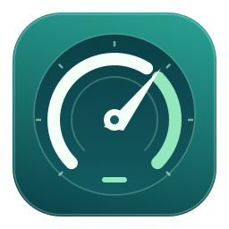

<p align="center">
  
</p>

<h1 align="center">gaugent</h1>

<p align="center">
  <strong>How much of your coding-agent subscription is left, one glance away.</strong><br>
  A tiny native macOS menu-bar app for Claude Code and Codex allowances.
</p>

gaugent shows Claude Code and Codex subscription allowances, reset times, and the lowest
current allowance in your menu bar. Missing tools, stale readings, and reached limits are
clearly marked. Available limits depend on what each installed CLI reports.

## Install

[Download for macOS](https://github.com/shivamx96/gaugent/releases/download/v0.1.0/gaugent-0.1.0.dmg)
· [Release notes](https://github.com/shivamx96/gaugent/releases)

Requires **macOS 14 or later**. The signed and notarized app supports **Apple Silicon and Intel**.

1. Open the DMG, drag gaugent into Applications, eject the disk image, and launch gaugent.
2. Install and sign in to Claude Code and/or Codex using a subscription account.
3. Open the menu-bar icon. **Settings → Tools** provides setup and sign-in help.

## Use and settings

- **⌥⌘U** opens the panel; **⌘R** refreshes readings.
- Automatic refresh is enabled by default: every five minutes, and on opening the panel
  when readings are older than a minute. Disable it in General settings if preferred.
- **General** contains appearance, menu-bar display, launch at login, refresh, low-allowance
  highlighting, and updates. The threshold changes visual highlighting, not notifications.
- **Tools** controls provider visibility and account setup; **Advanced** contains diagnostics,
  support, and **Saved readings → Reset**, which clears cached readings and fetches again.
- Use **⌘1–⌘3** to switch settings sections.

Release builds support verified in-app updates through **Settings → General → Check now**,
with automatic checks and optional background downloads. The first installation is manual.
Local builds without a feed and update-signing key provide a release-download link instead.

## What it reads

| Tool | How | Needs |
| --- | --- | --- |
| **Codex** | `codex app-server` account and rate-limit RPCs | `codex` on PATH, signed in with ChatGPT |
| **Claude Code** | The `get_usage` control request in a print-mode session with no tools, no MCP servers, no persistence | `claude` on PATH, signed in with claude.ai |

Grok, Gemini, Muse, and other tools can be added by implementing the small `UsageProvider`
protocol in `GaugentCore`.

## Private by construction

- gaugent never sends a prompt, never starts a turn, and never reads a token. Each tool's own
  CLI answers from its own session.
- The cache in `~/Library/Caches/com.shivamx96.gaugent` holds quota numbers and hashed account
  identities only, with owner-only permissions.
- After a failed refresh the last good reading is kept only when the same account is still
  signed in, and it is shown dimmed. Stale readings never trigger the low-allowance warning.
- When Claude Code's live fetch is declined (its usage endpoint rate-limits busy accounts),
  gaugent falls back to the reading the CLI last fetched for itself, stored in `.claude.json`
  next to the profile, and only when that profile matches the signed-in account.

## Build from source

Requires Xcode with Swift 6.1 or later and the macOS SDK.

```sh
git clone https://github.com/shivamx96/gaugent.git
cd gaugent
scripts/build-app.sh
open build/gaugent.app
```

For a development run without an app bundle:

```sh
swift run Gaugent
```

Run the tests with:

```sh
swift test
```

Render native light/dark fixtures for all settings sections and normal, stale, blocked, setup, and disabled panel states without
reading real CLI accounts:

```sh
GAUGENT_PREVIEW_DIR=/tmp/gaugent-previews swift test --filter PanelPreviewTests
```
